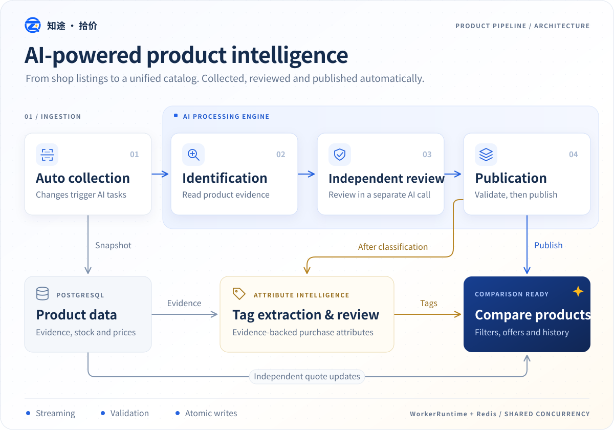
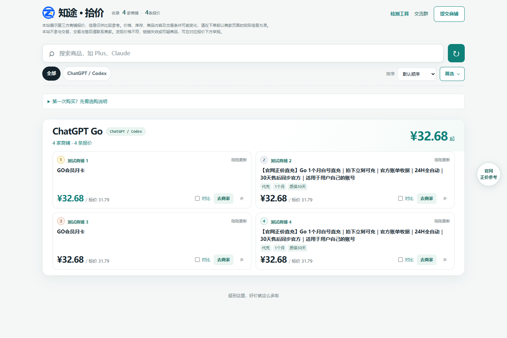
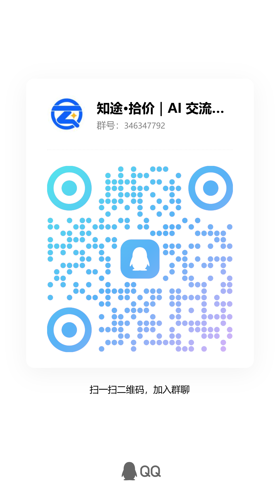
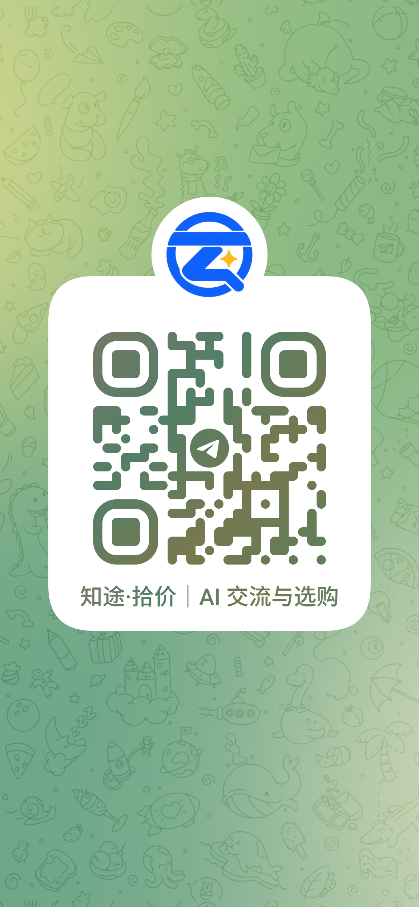

<p align="center">
  
</p>

<h1 align="center">知途 · 拾价</h1>

<p align="center">
  <a href="README.md">简体中文</a> · English
</p>

**Let AI help you choose offers—and let your own AI tools query them.**

知途 · 拾价 is a subscription and account price comparison platform built around an **AI shopping assistant and Skill / MCP access**. Find and compare offers through conversations on the website, or connect the pricing data to your own AI clients and workflows through a skill or MCP.

It aggregates offers for ChatGPT / Codex, Claude / Claude Code, Gemini, Grok, Cursor, and more from digital goods shops and automated storefronts. Listings cover top-up services, ready-to-use accounts, shared accounts, redemption codes, and related services such as email accounts, SMS verification, and residential IPs. Features include cross-shop comparison, price history, official regional pricing references, and AI / IP testing tools.

## ✨ AI shopping assistant and Skill / MCP access

Use the same product and pricing data for conversational shopping on the website or queries from your favorite AI tools.

### AI shopping assistant: describe your needs and compare offers

Describe your needs and budget. The AI shopping assistant helps you find and compare catalog offers, explaining recharge channels, warranty coverage, and purchase conditions. Ask follow-up questions to narrow down your choices.

> I already have a GPT account and want a Plus top-up under CNY 100 per month, preferably with warranty coverage.

### Skill / MCP access: bring price queries to your own AI tools

Install the comparison skill or connect an MCP client so your own assistant can **search products, compare merchant offers, and query price history**. Results retain source links, capture times, and purchase conditions for follow-up checks. You can also use the service to build your own comparison tools and automated workflows.

> Find ChatGPT Plus top-up offers and list the merchants, prices, warranty terms, and capture times.

Register through the homepage's Skill / MCP entry, apply once, and collect the shared key after approval. For skill access, send the page's installation instruction to your agent and save the key in that agent's native configuration; no MCP setup is needed. See the separate [Skill setup guide](docs/skill.md) and [MCP setup guide](docs/mcp.md).

## Product aggregation and comparison



The same subscription, multiple offers. Filter by platform, delivery method, access duration, and warranty terms to compare prices and availability across shops.



## Installation

### Build and run with npm

Use Node.js 26 LTS, PostgreSQL 16+, and Redis 7+. Create a PostgreSQL database and start Redis, then run from the repository root:

```bash
git clone https://github.com/hhtower/price-comparison.git
cd price-comparison
npm ci
cp .env.example .env
# Set DATABASE_URL, REDIS_URL, ADMIN_PASSWORD, and PUBLIC_SITE_URL in .env
# Initialize the complete database schema
npm run db:migrate
npm run build
npm start
```

In PowerShell, copy the configuration with `Copy-Item .env.example .env`. Replace the example admin password and set `PUBLIC_SITE_URL` to your site's HTTPS origin. Open `http://localhost:3000`; the admin dashboard is at `/admin`. A fresh installation has no business data: add and approve shops in the dashboard before crawling products.

For development, run `npm run dev` and open the frontend address printed in the terminal. See [.env.example](.env.example) for settings and [WORKFLOW.md](WORKFLOW.md) for worker and deployment details. AI is disabled by default; enabling it sends product evidence to your configured provider and may incur charges.

The AI shopping assistant requires a separate feature switch and worker; see the [deployment workflow](WORKFLOW.md) for setup. When enabled, it sends shopping conversations and candidate product evidence to the configured model provider.

### Install with Docker

Requires Docker Engine / Desktop and Compose v2. Build the image locally and start PostgreSQL, Redis, the API, and basic workers:

```bash
git clone https://github.com/hhtower/price-comparison.git
cd price-comparison
cp .env.example .env
# Set at least ADMIN_PASSWORD and PUBLIC_SITE_URL
# Local Compose overrides DATABASE_URL and REDIS_URL to use its bundled services

docker compose -f docker-compose.dev.yml up -d postgres redis
docker compose -f docker-compose.dev.yml run --rm --build migrate
docker compose -f docker-compose.dev.yml up -d --build
```

Open `http://localhost:3000`. Database state persists in Docker volumes. The bundled database password is suitable only for local development. For external databases, see [docker-compose.yml](docker-compose.yml) and the [deployment workflow](WORKFLOW.md).

## Community

| QQ group | Telegram group |
| --- | --- |
|  |  |

## Contributing

Bug reports, feature suggestions, and pull requests are welcome. Use the issue templates and read the [contribution guide](CONTRIBUTING.md) first. Community participants are expected to follow the [code of conduct](CODE_OF_CONDUCT.md).

The repository uses npm workspaces:

```text
apps/web/           React frontend and UI tests
apps/api/           NestJS API, workers, migrations, and backend tests
packages/catalog/   Shared product rules and types
scripts/            Local development launcher
docs/               Screenshots, shop scoring rules, and deployment notes
```

See the [documentation index](docs/README.md) for more information. Report security issues as described in [SECURITY.md](SECURITY.md).

## License

[GNU GPL v3.0](LICENSE) (`GPL-3.0-only`). Commercial use is permitted. Distribution of this program or modified versions must comply with GPL requirements, including notices, corresponding source, and the same license. Third-party dependencies and materials retain their own licenses.
