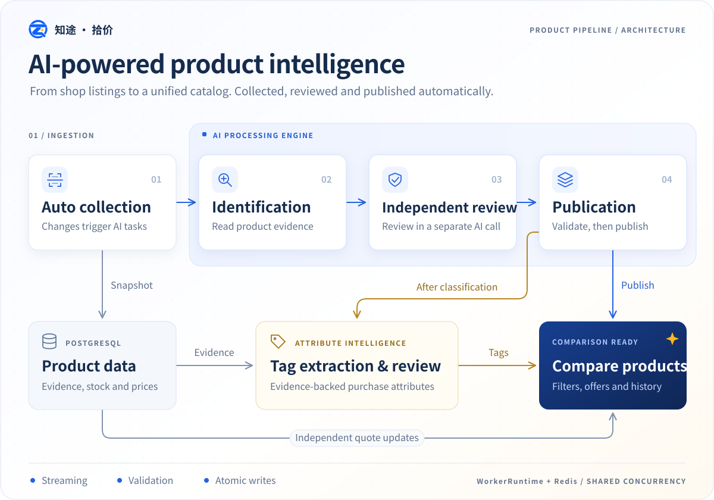

<p align="center">
  
</p>

<h1 align="center">知途 · 拾价</h1>

<p align="center">
  <a href="README.md">简体中文</a> · English
</p>

A self-hosted price comparison site for AI products, with shop crawling, quote comparison, product normalization, price history, and an admin dashboard. Built with React, NestJS / Fastify, PostgreSQL, and Redis. An automated AI pipeline identifies crawled products, independently reviews and publishes their standard classifications, and extracts and reviews purchase attributes to support cross-shop comparison in a shared catalog.



Screenshots illustrate the interface; displayed quotes are not current prices or shop endorsements.


## Installation

### Build and run with npm

Requires Node.js 22.13+ (LTS), PostgreSQL 16+, and Redis 7+. Create a PostgreSQL database and start Redis, then run from the repository root:

```bash
git clone https://github.com/hhtower/price-comparison.git
cd price-comparison
npm ci
cp .env.example .env
# Set DATABASE_URL, REDIS_URL, ADMIN_PASSWORD, and PUBLIC_SITE_URL in .env
# Initialize the complete database schema
npm run db:migrate
npm run build
npm start
```

In PowerShell, copy the configuration with `Copy-Item .env.example .env`. Replace the example admin password and set `PUBLIC_SITE_URL` to your site's HTTPS origin. Open `http://localhost:3000`; the admin dashboard is at `/admin`. A fresh installation has no business data: add and approve shops in the dashboard before crawling products.

For development, run `npm run dev` and open the frontend address printed in the terminal. See [.env.example](.env.example) for settings and [WORKFLOW.md](WORKFLOW.md) for worker and deployment details. AI is disabled by default; enabling it sends product evidence to your configured provider and may incur charges.

### Install with Docker

Requires Docker Engine / Desktop and Compose v2. Build the image locally and start PostgreSQL, Redis, the API, and basic workers:

```bash
git clone https://github.com/hhtower/price-comparison.git
cd price-comparison
cp .env.example .env
# Set at least ADMIN_PASSWORD and PUBLIC_SITE_URL
# Local Compose overrides DATABASE_URL and REDIS_URL to use its bundled services

docker compose -f docker-compose.dev.yml up -d postgres redis
docker compose -f docker-compose.dev.yml run --rm --build migrate
docker compose -f docker-compose.dev.yml up -d --build
```

Open `http://localhost:3000`. Database state persists in Docker volumes. The bundled database password is suitable only for local development. For external databases, see [docker-compose.yml](docker-compose.yml) and the [deployment workflow](WORKFLOW.md).

## Community

| QQ group | Telegram group |
| --- | --- |
|  |  |

## Contributing

Bug reports, feature suggestions, and pull requests are welcome. Use the issue templates and read the [contribution guide](CONTRIBUTING.md) first. Community participants are expected to follow the [code of conduct](CODE_OF_CONDUCT.md).

The repository uses npm workspaces:

```text
apps/web/           React frontend and UI tests
apps/api/           NestJS API, workers, migrations, and backend tests
packages/catalog/   Shared product rules and types
scripts/            Local development launcher
docs/               Screenshots, shop scoring rules, and deployment notes
```

See the [documentation index](docs/README.md) for more information. Report security issues as described in [SECURITY.md](SECURITY.md).

## License

[GNU GPL v3.0](LICENSE) (`GPL-3.0-only`). Commercial use is permitted. Distribution of this program or modified versions must comply with GPL requirements, including notices, corresponding source, and the same license. Third-party dependencies and materials retain their own licenses.
