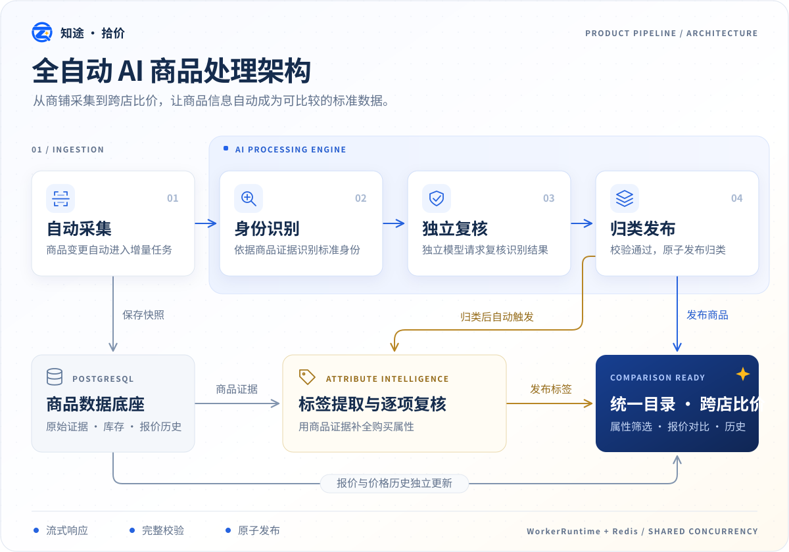
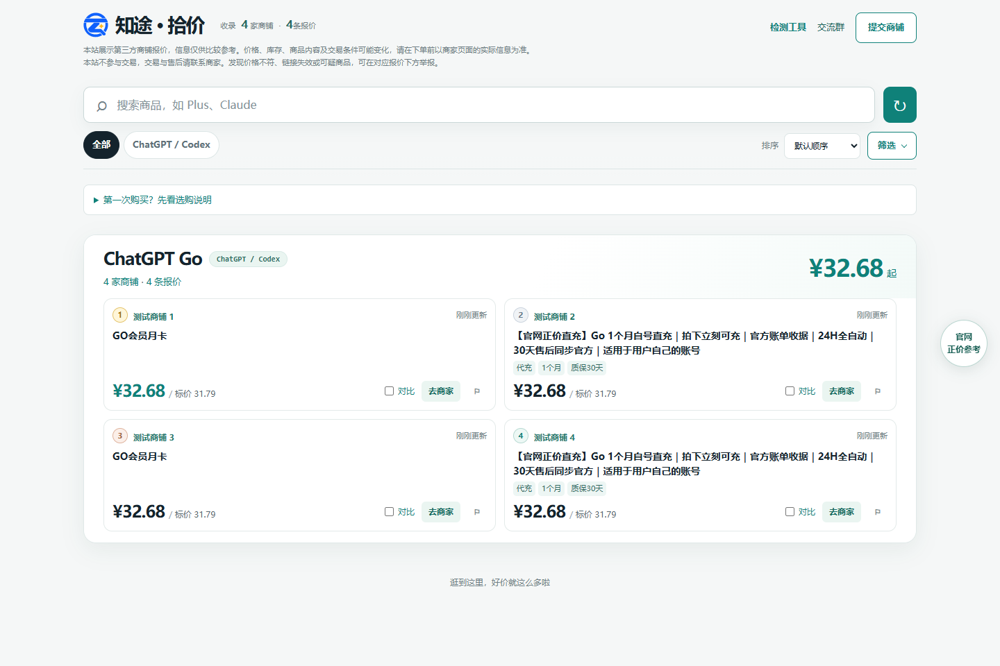
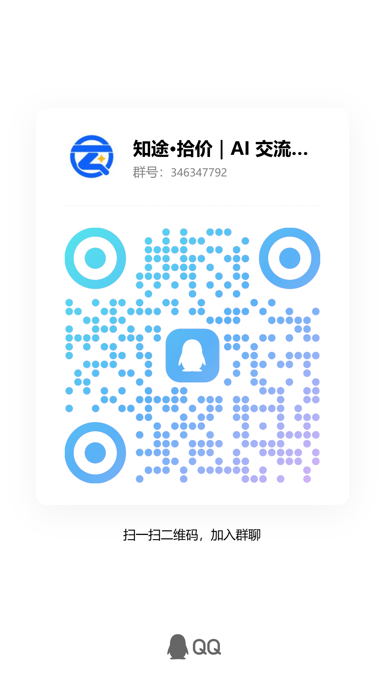
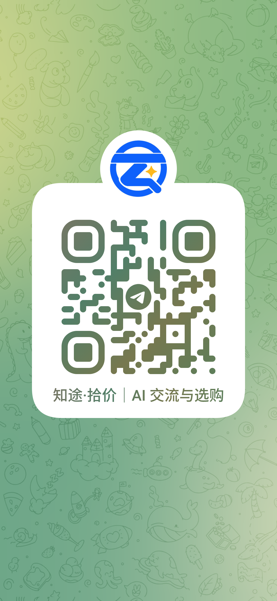

<p align="center">
  
</p>

<h1 align="center">知途 · 拾价</h1>

<p align="center">
  简体中文 · <a href="README.en.md">English</a>
</p>

一个自部署的 AI 商品比价站，支持商铺采集、报价比较、标准商品归类、价格历史和管理后台。使用 React、NestJS / Fastify、PostgreSQL 和 Redis；AI 自动化流程将采集后的商品依次进行身份识别、独立复核与标准化归类，并提取和复核购买属性标签，汇总到统一目录用于跨商铺比价。



以下为界面示例，截图中的报价不代表当前价格或商铺推荐。



## 使用方式

### npm 编译运行

推荐使用 Node.js 26 LTS；需要 PostgreSQL 16+ 和 Redis 7+。先创建数据库并启动 Redis，在项目根目录执行：

```bash
git clone https://github.com/hhtower/price-comparison.git
cd price-comparison
npm ci
cp .env.example .env
# 编辑 .env：设置 DATABASE_URL、REDIS_URL、ADMIN_PASSWORD、PUBLIC_SITE_URL
# 初始化完整数据库结构
npm run db:migrate
npm run build
npm start
```

PowerShell 使用 `Copy-Item .env.example .env` 复制配置。替换示例管理密码；`PUBLIC_SITE_URL` 为站点的 HTTPS origin。默认访问 `http://localhost:3000`，管理后台为 `/admin`。新安装不包含业务数据，需在后台添加并审核商铺，再采集商品。

开发模式运行 `npm run dev`，访问终端显示的前端地址。配置项见 [.env.example](.env.example)，worker 和部署说明见 [WORKFLOW.md](WORKFLOW.md)。AI 默认关闭，启用后会向配置的模型服务发送商品证据并可能产生费用。

### Docker 安装

需要 Docker Engine / Desktop 和 Compose v2。以下命令构建本地镜像，并启动 PostgreSQL、Redis、API 和基础 worker：

```bash
git clone https://github.com/hhtower/price-comparison.git
cd price-comparison
cp .env.example .env
# 编辑 .env，至少替换 ADMIN_PASSWORD 并设置 PUBLIC_SITE_URL
# 本地 Compose 会覆盖 DATABASE_URL、REDIS_URL，连接内置数据库与 Redis

docker compose -f docker-compose.dev.yml up -d postgres redis
docker compose -f docker-compose.dev.yml run --rm --build migrate
docker compose -f docker-compose.dev.yml up -d --build
```

访问 `http://localhost:3000`。数据库保存在 Docker volume 中。内置数据库示例密码仅适合本机开发。使用外部数据库的部署参考 [docker-compose.yml](docker-compose.yml) 和 [开发与部署流程](WORKFLOW.md)。

## 联系方式

| QQ 群 | Telegram 群 |
| --- | --- |
|  |  |

## 贡献

欢迎通过 Issue 模板反馈问题或建议、通过 Pull Request 提交改进。开始前请阅读 [贡献指南](CONTRIBUTING.md)，参与社区时请遵守 [行为准则](CODE_OF_CONDUCT.md)。

项目使用 npm workspaces：

```text
apps/web/           React 前端与界面测试
apps/api/           NestJS API、worker、迁移与后端测试
packages/catalog/   前后端共用的商品规则与类型
scripts/            本地开发启动入口
docs/               产品截图、商铺评分规则与部署说明
```

更多说明见 [文档索引](docs/README.md)，安全问题请按 [SECURITY.md](SECURITY.md) 反馈。

## 许可证

[GNU GPL v3.0](LICENSE)（`GPL-3.0-only`）。允许商业使用；分发本程序或修改版时须遵守 GPL 的声明保留、对应源码提供和相同许可要求。第三方依赖及资料遵循各自许可证。
