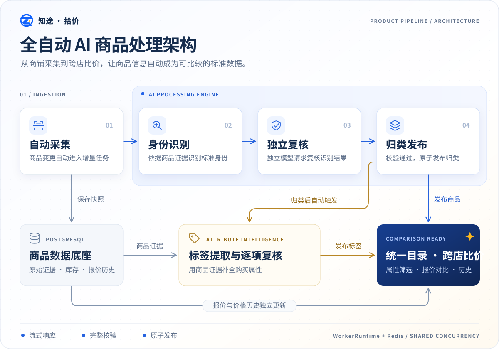
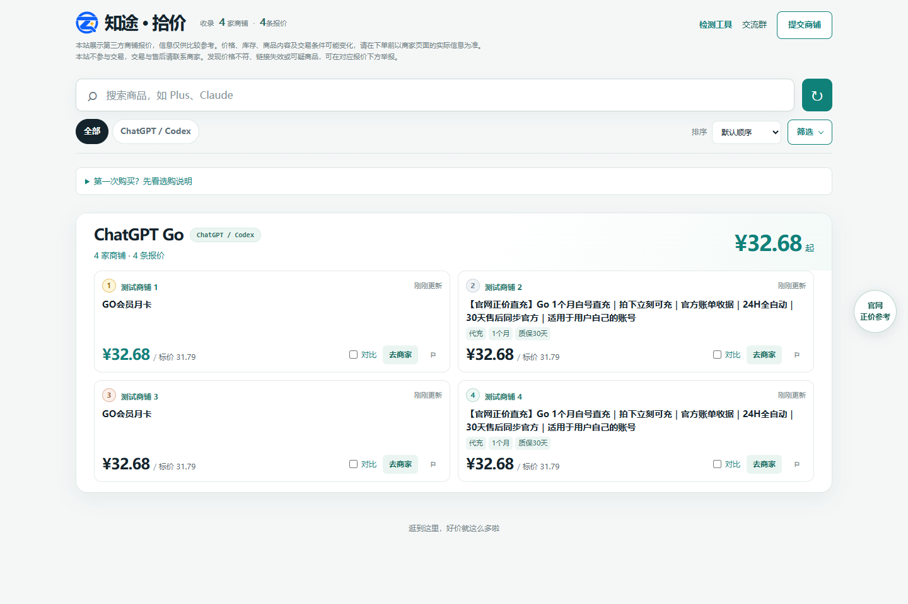
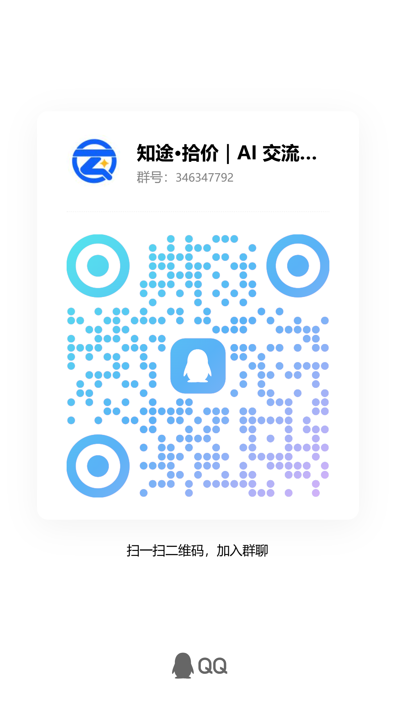

<p align="center">
  
</p>

<h1 align="center">知途 · 拾价</h1>

<p align="center">
  简体中文 · <a href="README.en.md">English</a>
</p>

**让 AI 帮你挑选报价，也让你的 AI 工具直接查询报价。**

知途 · 拾价是以 **AI 导购助手与 Skill / MCP 报价接入**为核心的订阅与账号比价平台。站内用对话筛选、比较商品，站外通过 Skill 或 MCP 将报价接入你自己的 AI 客户端与工作流。

平台聚合卡网、发卡站的 ChatGPT / Codex、Claude / Claude Code、Gemini、Grok、Cursor 等报价，覆盖代充、成品号、共享账号、兑换码，以及邮箱、接码、住宅 IP 等配套服务。支持跨商铺比价、价格走势、官方地区价参考及 AI / IP 检测。

## ✨ AI 导购助手与 Skill / MCP 接入

同一份商品与报价数据，既能在网站里对话选购，也能在你常用的 AI 工具中调用。

### AI 导购助手：说出需求，帮你筛选和比较

说出需求与预算，AI 导购助手帮你筛选、比较站内商家报价，并说明充值渠道、质保和购买条件。你可以继续追问，逐步找到适合自己的商品。

> 已有 GPT 账号，想找 Plus 代充，每月预算 100 元以内，优先有质保的。

### Skill / MCP 接入：让你的 AI 工具也能查价

安装比价 Skill，或连接 MCP 服务，让你自己的助手完成**商品搜索、商家报价比较和价格历史查询**。返回结果保留来源链接、采集时间和购买条件，方便继续核对与选购，也可用于构建自己的比价工具和自动化工作流。

> 查一下 ChatGPT Plus 代充报价，列出商家、价格、质保条件和采集时间。

从首页「Skill / MCP 接入」注册并提交一次申请，审核通过后领取共用密钥。使用 Skill 时，把页面安装指令交给智能体，并在各自的原生配置中填写密钥，无需配置 MCP。两种方式的安装与使用分别见 [Skill 接入](docs/skill.md)和 [MCP 接入](docs/mcp.md)。

## 商品聚合与比价



同款订阅，多家报价。按平台、交付方式、使用期限和质保条件筛选，集中对比各商铺的价格与库存。



## 使用方式

### npm 编译运行

推荐使用 Node.js 26 LTS；需要 PostgreSQL 16+ 和 Redis 7+。先创建数据库并启动 Redis，在项目根目录执行：

```bash
git clone https://github.com/hhtower/price-comparison.git
cd price-comparison
npm ci
cp .env.example .env
# 编辑 .env：设置 DATABASE_URL、REDIS_URL、ADMIN_PASSWORD、PUBLIC_SITE_URL
# 初始化完整数据库结构
npm run db:migrate
npm run build
npm start
```

PowerShell 使用 `Copy-Item .env.example .env` 复制配置。替换示例管理密码；`PUBLIC_SITE_URL` 为站点的 HTTPS origin。默认访问 `http://localhost:3000`，管理后台为 `/admin`。新安装不包含业务数据，需在后台添加并审核商铺，再采集商品。

开发模式运行 `npm run dev`，访问终端显示的前端地址。配置项见 [.env.example](.env.example)，worker 和部署说明见 [WORKFLOW.md](WORKFLOW.md)。AI 默认关闭，启用后会向配置的模型服务发送商品证据并可能产生费用。

AI 导购助手需单独启用并运行对应 worker，配置与启动方式见 [开发与部署流程](WORKFLOW.md)。启用后会向配置的模型服务发送对话需求与候选商品资料。

### Docker 安装

需要 Docker Engine / Desktop 和 Compose v2。以下命令构建本地镜像，并启动 PostgreSQL、Redis、API 和基础 worker：

```bash
git clone https://github.com/hhtower/price-comparison.git
cd price-comparison
cp .env.example .env
# 编辑 .env，至少替换 ADMIN_PASSWORD 并设置 PUBLIC_SITE_URL
# 本地 Compose 会覆盖 DATABASE_URL、REDIS_URL，连接内置数据库与 Redis

docker compose -f docker-compose.dev.yml up -d postgres redis
docker compose -f docker-compose.dev.yml run --rm --build migrate
docker compose -f docker-compose.dev.yml up -d --build
```

访问 `http://localhost:3000`。数据库保存在 Docker volume 中。内置数据库示例密码仅适合本机开发。使用外部数据库的部署参考 [docker-compose.yml](docker-compose.yml) 和 [开发与部署流程](WORKFLOW.md)。

## 联系方式

| QQ 群 | Telegram 群 |
| --- | --- |
|  |  |

## 贡献

欢迎通过 Issue 模板反馈问题或建议、通过 Pull Request 提交改进。开始前请阅读 [贡献指南](CONTRIBUTING.md)，参与社区时请遵守 [行为准则](CODE_OF_CONDUCT.md)。

项目使用 npm workspaces：

```text
apps/web/           React 前端与界面测试
apps/api/           NestJS API、worker、迁移与后端测试
packages/catalog/   前后端共用的商品规则与类型
scripts/            本地开发启动入口
docs/               产品截图、商铺评分规则与部署说明
```

更多说明见 [文档索引](docs/README.md)，安全问题请按 [SECURITY.md](SECURITY.md) 反馈。

## 许可证

[GNU GPL v3.0](LICENSE)（`GPL-3.0-only`）。允许商业使用；分发本程序或修改版时须遵守 GPL 的声明保留、对应源码提供和相同许可要求。第三方依赖及资料遵循各自许可证。
